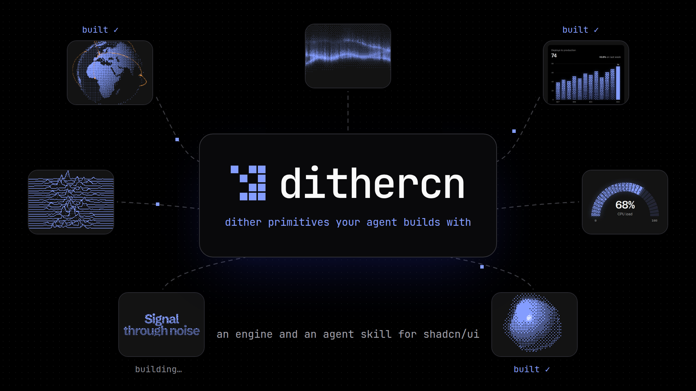

<p align="center">
  
</p>

<p align="center">
  <a href="https://github.com/opencoredev/dithercn/stargazers"></a>
  <a href="https://x.com/leodev"></a>
</p>

dithercn gives your coding agent the primitives to add dithers to anything in your app: a dither engine and a skill that teaches it. Ask for a background, a chart, a loading state or a dithered photo, and your agent builds it in your shadcn theme.

It installs with the shadcn CLI as plain source you own, and works with Claude Code, Codex, Cursor and any agent that reads skills.

[Read the installation guide](<content/docs/(root)/installation.mdx>) · [Write your own dither](content/docs/engine/write-your-own.mdx)

- A dither engine (`lib/dither`): a WebGL shader for anything that moves, SVG and CSS fills for static shapes, image dithering, and PNG, SVG and CSS export
- An agent skill that teaches your agent to write fields, place a dither on a landing page or dashboard, and check it in light, dark and reduced motion
- 52 example components across backgrounds, charts, interface, text and images, each a starting point to install and edit
- Colours from your theme: the dither ink and paper map to your `--primary` and `--background`, and switch with light and dark mode
- Motion, resizing, offscreen pausing and reduced motion handled by the engine

## Install

From a project that uses shadcn/ui, Tailwind CSS v4 and React 19:

```bash
npx shadcn@latest add <site>/r/dithercn-skill.json
```

This adds the engine in `lib/dither/`, the skill in `.agents/skills/dithercn/` and `.claude/skills/dithercn/`, and the `--dither-*` CSS variables. Until the site is public, run it locally (see [Develop](#develop)) and use `http://localhost:3000` as `<site>`. Any example installs the same way, for example `<site>/r/dither-gradient.json`.

## Usage

Ask your agent for the dither you want, in plain words:

```text
Add a slow dithered aurora behind the hero headline, in our brand colour,
and keep the headline readable.
```

The skill sends the agent to the engine, the closest example and the checks it runs before it's done. To write one by hand, a dither is a GLSL field that returns a tone from 0 (paper) to 1 (ink):

```tsx
"use client";

import { DitherShader } from "@/lib/dither";

const FIELD = `
float field(vec2 uv, vec2 res, float t) {
  vec2 p = vec2(uv.x * res.x / res.y, uv.y);
  return fbm(p * 2.5 + vec2(t * 0.03, 0.0)) * smoothstep(0.0, 0.6, uv.y);
}
`;

export const Clouds = () => (
  <DitherShader className="absolute inset-0" field={FIELD} stillTime={4} />
);
```

## For agents

The skill is the main surface: `/.well-known/agent-skills/index.json` lists it and `/.well-known/agent-skills/dithercn/SKILL.md` serves it. The site also serves `/llms.txt`, `/llms-full.txt`, a Markdown version of every docs page (append `.md`), an API catalog at `/.well-known/api-catalog` and an OpenAPI description at `/openapi.json`.

## Develop

```bash
pnpm install
pnpm dev
```

Then open http://localhost:3000. Other scripts:

- `pnpm build` builds the registry, then the site
- `pnpm registry:build` renders the skill into `.generated/`, merges `registry/*.json` into `registry.json` (both generated, gitignored), checks it, and writes the items to `public/r/`
- `pnpm check` runs formatting and lint checks (ultracite)
- `pnpm typecheck` runs TypeScript

Set `SITE_URL` to the public origin when deploying. Without it, a Vercel production build uses the project's production URL, a Vercel preview uses its deployment URL, and anywhere else falls back to `http://localhost:3000`.

## Project structure

```
├── content/docs/       # Docs (MDX). (root) is "Get started", engine/ the engine guides, examples/ the overview, the rest example groups
├── skills/dithercn/    # The agent skill (SKILL.md and references), served and shipped as dithercn-skill
├── components/dithercn/ # Shipped components, one file each
├── lib/dither/         # dither-core, the shipped engine
├── examples/           # Docs demos (site only)
├── registry/           # Registry items: base.json plus one fragment per group
├── scripts/            # build-registry.ts, generate-blue-noise.ts
├── public/r/           # Built registry items (generated by pnpm registry:build)
├── app/                # Next.js app: site, docs, OG images, agent routes
├── components/         # Site components (ui/ holds the shadcn primitives)
└── lib/                # Docs source, catalog, agent discovery
```

## Credits

[DitherKit](https://www.tripwire.sh/dither-kit) by Boring Software set the quality bar for dithercn, and several of our ideas come straight from it: the gradient, dotted, hatched and solid fills, bloom under fills, a named colour palette that works in light and dark, a chart crosshair whose tooltip glides as you scrub, legend hover and click-to-lock, live knobs in the docs, generative avatars, and buttons whose dither thickens on hover and press. We wrote our own code and look, but the ideas are theirs. DitherKit in turn credits [EvilCharts](https://evilcharts.com) by legions-developer for the dithered chart style, so thanks to them too.

Docs run on [Fumadocs](https://fumadocs.dev), and icons come from [Hugeicons](https://hugeicons.com).

## License

[MIT](./LICENSE)
